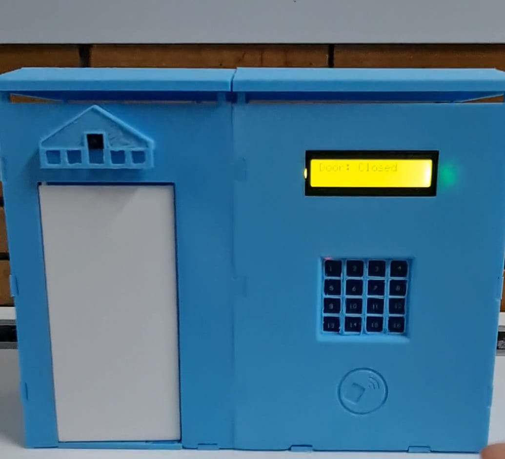

# 🔐 Smart Door – Home Security System with an Intelligent Door

A low-cost, open-source, cloud-free smart door lock built around two ESP32 boards. The door can be opened with a **PIN code**, an **RFID card**, or **remotely from a local web app**, and the entrance is monitored through a **live video stream** from a camera mounted above the door. An **MQ-2 gas sensor** adds a safety feature: the door opens automatically when gas is detected and stays open until the gas level drops.

> Project developed for the **Electrical Machines and Drives** (*Mașini Electrice și Acționări*) course, Faculty of Automatic Control and Computer Science, **National University of Science and Technology POLITEHNICA Bucharest**, academic year 2025–2026.


---

## Table of Contents

- [Project Goals](#project-goals)
- [Features](#features)
- [How It Compares to Commercial Solutions](#how-it-compares-to-commercial-solutions)
- [System Architecture](#system-architecture)
- [Hardware Components](#hardware-components)
- [User Interface](#user-interface)
  - [Keypad Layout](#keypad-layout)
  - [LCD Messages](#lcd-messages)
  - [Audio Feedback](#audio-feedback)
- [Security Behavior](#security-behavior)
- [Web Application](#web-application)
- [Getting Started](#getting-started)
- [Enclosure (3D Printing)](#enclosure-3d-printing)
- [Datasheets](#datasheets)
- [Team](#team)

---

## Project Goals

1. **Accessible and robust home security.** Commercial smart locks are expensive and often tied to the manufacturer's ecosystem. This project is easy to replicate, uses inexpensive components and open-source software, and keeps your data safe by not relying on any cloud service.
2. **Better protection against typical break-in methods.** Lock picking, lost keys and duplicated keys are eliminated by replacing the traditional key with a PIN code and RFID cards, together with an automatic lockout after repeated failed attempts.
3. **Real-time entrance monitoring.** The system acts as both a traditional peephole and a security camera. From any device on the local network, you can see who is at the door and grant or deny access from anywhere inside the home.
4. **Modularity.** The camera and the main controller are separate modules that communicate wirelessly over **ESP-NOW**, which makes installation, customization, maintenance and troubleshooting simple. Parts can also be purchased and replaced independently.

## Features

- 🔢 **PIN code access** via a capacitive touch keypad
- 💳 **RFID card access** (125 kHz)
- 🌐 **Remote opening** from the web application
- 📹 **Live video stream** of the entrance, available on the local network
- 🖥️ **16x2 LCD** showing door status and guidance messages
- 🔊 **Buzzer** providing audio feedback for every action
- 🚫 **Automatic lockout** after 3 consecutive failed attempts (PIN or unregistered RFID card)
- ⏱️ **Auto-close** 5 seconds after the door opens
- 🔑 **On-device management:** change the PIN, enroll a new RFID card, and display the web app's IP address
- 🚪 **Forced-entry detection** using a magnetic reed switch
- 💨 **Gas detection:** an MQ-2 sensor automatically opens the door when gas is detected and keeps it open until the gas level drops, helping occupants evacuate and ventilate the space
- 🔒 **Fully local operation:** no cloud, no external accounts
- 🔋 **Portable power:** runs from a standard USB power bank

## How It Compares to Commercial Solutions

| | Yale Linus L2 | August Smart Lock Wi-Fi | Nuki Smart Lock Ultra | **This project** |
|---|---|---|---|---|
| Easy installation | ✅ | ✅ | ✅ | ✅ |
| Smart-home integration | ✅ | ✅ (voice assistants) | ✅ | Local web app |
| Built-in video monitoring | ❌ | ❌ | ❌ | ✅ |
| Works without the manufacturer's cloud/app | ❌ | ❌ | Partially | ✅ |
| Cost | High | High | High | **Low** |
| Automatic lockout after failed attempts | – | – | – | ✅ |

Commercial locks generally use a DC motor (brushed or brushless, in Nuki's case) with a mechanical reduction gear to rotate the lock cylinder. This project uses a hobby servo to actuate the door, keeping the mechanics simple and cheap.

Key advantages of this solution:

- Two microcontrollers separate the tasks, making the design modular and easy to extend
- Low implementation cost
- Automatic lockout after failed attempts
- Enhanced data security: the video stream is served locally with no cloud involved

## System Architecture

The system is built from two boards:

| Board | Role |
|---|---|
| **Plusivo ESP32** | Main unit. Runs the door logic and controls the servo, LCD, keypad, RFID reader, buzzer, reed switch and gas sensor. Communicates with the camera board. |
| **XIAO ESP32S3** | Camera unit. Handles the OV3660 camera and the video stream. |

The two boards communicate wirelessly through **ESP-NOW**, so no wiring is needed between the camera (mounted above the door) and the main panel.

```
                ┌─────────────────────────┐        ESP-NOW        ┌──────────────────────┐
                │      Plusivo ESP32      │ ◄───────────────────► │   XIAO ESP32S3       │
                │      (door logic)       │                       │   + OV3660 camera    │
                └───────────┬─────────────┘                       └──────────┬───────────┘
                            │                                                │
   ┌───────────┬────────────┼────────────┬────────────┐                      │
   │           │            │            │            │                      │
 TTP229     RDM6300     LCD 1602      Buzzer     SG90 servo            Local web app
 keypad     RFID        (I2C)                    + reed switch      (video + remote open)
                                                 + MQ-2 gas sensor
```

## Hardware Components

| Component | Purpose | Supply |
|---|---|---|
| **Plusivo ESP32** dev board | Main processing unit and door logic. Chosen for its higher power, larger number of pins and dedicated peripherals (I2C SDA/SCL, etc.) | 5 V |
| **XIAO ESP32S3** dev board | Dedicated video-stream processing | 5 V |
| **SG90 servo motor (180°)** | Actuator that opens and closes the door | 5 V |
| **LCD 1602 with I2C interface** (yellow-green backlight) | Shows door status and messages | 5 V |
| **TTP229 capacitive touch keypad** (4x4, 16 keys) | PIN entry and access to all other functions | 3.3 V |
| **RDM6300 RFID reader** | Alternative card-based entry | 5 V |
| **Active buzzer** | Audio feedback mirroring the LCD messages | 5 V |
| **OV3660 camera** | Entrance monitoring | 5 V |
| **Magnetic reed switch** | Detects unexpected physical door opening | – |
| **MQ-2 gas sensor** | Detects gas and triggers automatic door opening | – |
| **HAMA portable power bank** (2x USB-A) | Powers the whole installation (one USB-A to USB-C cable per board) | – |
| **3D-printed enclosure** | Houses the components; includes a custom camera cover | – |

## User Interface

### Keypad Layout

The TTP229 provides a 4x4 matrix of keys numbered 1 to 16.

| Key | Function |
|---|---|
| **1 – 9** | PIN entry |
| **12** | Cancel the new-PIN / new-card enrollment |
| **13** | Confirm the option to set a new PIN |
| **14** | Display the web app's IP address on the LCD |
| **16** | Confirm the option to enroll a new RFID card |

### LCD Messages

| Message | Meaning |
|---|---|
| `Door: Closed` / `System Ready` | System started and idle |
| `Enter PIN:` / `****` | PIN being typed (one `*` per digit) |
| `Door: Opening` / `PIN: Granted` | Correct PIN entered |
| `Door: Opening` / `RFID: Granted` | Valid RFID card scanned |
| `Door: Open` / `Auto-close: 5s` | Door fully open, countdown begins |
| `Door: Open` / `Closing in 04s` | Countdown to closing |
| `Door: Closing` | Door is closing |
| `Enter PIN:` / `Fail 1/3`, `Fail 2/3` | Wrong PIN entered |
| `** LOCKED OUT **` / `Wait 30 seconds` | Third failed attempt – system locked |
| `** LOCKED OUT **` / `Wait: 29s` | Lockout countdown |
| `Door: Closed` / `Lockout expired` | Lockout over, you can try again |
| `Fail 1/3` | Invalid RFID card scanned |
| `13=NewPIN 16=Crd` / `12=Cancel` | Settings menu |
| `Enter new PIN:` | New PIN entry started |
| `PIN Updated!` / `Door: Closed` | PIN changed successfully |
| `Door: Closed` / `Cancelled` | PIN change cancelled |
| `Card Updated!` / `Door: Closed` | New RFID card enrolled |
| `Door: Closed` / `!Physical open!` | Reed switch detected an unexpected opening |

### Audio Feedback

The buzzer accompanies each key press, a correct PIN, a valid card scan, and every wrong PIN or invalid card scan, so the user gets feedback even without looking at the screen.

## Security Behavior

- **Opening:** after a correct PIN or an authorized card, the door opens automatically and closes again after **5 seconds**.
- **Lockout:** after **3 consecutive failed attempts** (wrong PIN or unregistered card), the system locks for **30 seconds**, with a live countdown on the LCD.
- **Forced entry:** if the reed switch detects the door being opened without authorization, the event is reported on the LCD.
- **Gas safety:** if the MQ-2 sensor detects gas, the door opens automatically so people can leave the home quickly. The door stays open (the 5-second auto-close is suspended) until the gas level inside drops back to a safe value, then it returns to normal operation.
- **Privacy:** the video stream never leaves your local network.

## Web Application

The web app is served locally by the system and is reachable from any device on the same network. It provides:

- Live video stream from the entrance camera
- Remote door opening
- Additional status information

To find the app's address, press key **14** on the keypad: the IP address is shown on the LCD.

## Getting Started

> ⚠️ Adapt the paths, board names and pin mappings below to match the actual contents of this repository.

### Prerequisites

- [Arduino IDE](https://www.arduino.cc/en/software) with the **ESP32 board package** (Espressif) installed
- Libraries for the LCD (I2C), servo, TTP229 keypad, RDM6300 RFID reader and the ESP32 camera (add the exact list used in your sketches)
- A 2.4 GHz Wi-Fi network

### Setup

1. **Clone the repository**
   ```bash
   git clone https://github.com/<your-username>/<your-repo>.git
   cd <your-repo>
   ```
2. **Wire the components** following the electrical schematic (see `assets/wiring` or the project documentation).
3. **Flash the main board** (Plusivo ESP32) with the door-logic sketch.
4. **Flash the camera board** (XIAO ESP32S3) with the camera sketch.
5. **Configure Wi-Fi credentials** in the code, and make sure the two boards are set up to talk to each other over ESP-NOW (MAC addresses).
6. **Power both boards** from the power bank (one USB-A to USB-C cable per board).
7. **Press key 14** on the keypad to read the IP address and open the web app in your browser.

## Enclosure (3D Printing)

The enclosure was designed in **Onshape** after measuring each component and recreating it in CAD, then printed on a 3D printer. It includes dedicated slots for the electronic components and a custom cover that protects the camera mounted above the door.

## Datasheets

- [ESP32 dev kits](https://docs.espressif.com/projects/esp-dev-kits/en/latest/esp32/esp-dev-kits-en-master-esp32.pdf)
- [ESP32-S3](https://cdn-shop.adafruit.com/product-files/5477/esp32-s3_datasheet_en.pdf)
- [LCD 1602](https://www.vishay.com/docs/37484/lcd016n002bcfhet.pdf)
- [TTP229 touch keypad IC](https://www.elecrow.com/download/TOUCH_IC_TTP229.pdf)
- [RDM6300 RFID reader](https://www.handsontec.com/dataspecs/module/RDM6300.pdf)
- [Active buzzer](https://www.farnell.com/datasheets/2171929.pdf)
- [OV3660 camera](https://manuals.plus/ae/1005004143133100)

## Team

| Member | Contributions |
|---|---|
| **Teodor-Andrei Constantinescu** | Initial prototyping and feasibility testing; electronics assembly and soldering; solution testing |
| **Alexandru-Petre-Cristian Drăgan** | 3D printing of the enclosure; web application design and implementation; electronics assembly; online enclosure design; demo video |
| **Victor-Mihail Părăușanu** | Project documentation; online enclosure design; solution testing and photo documentation; demo video |

All members jointly defined the initial concept and use cases and designed and wrote the door's operating logic in the Arduino environment.
